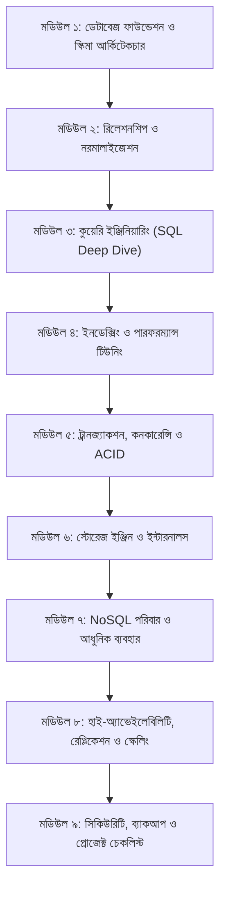
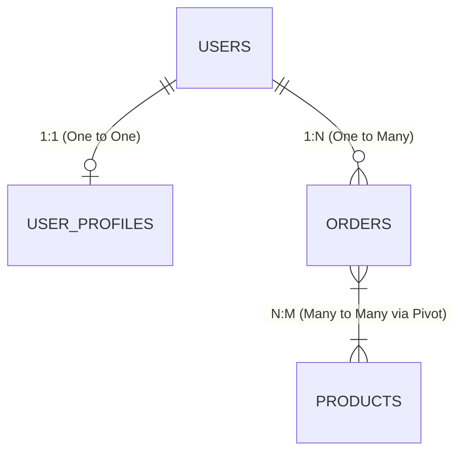
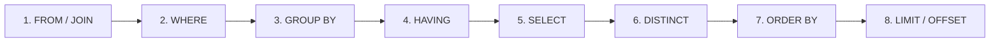
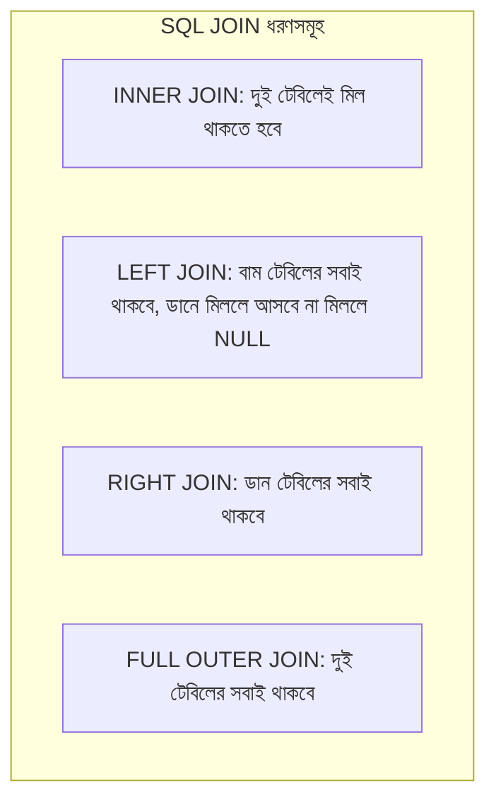
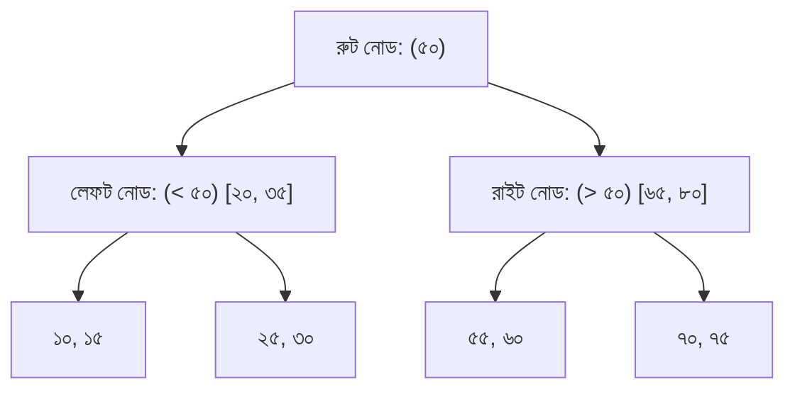
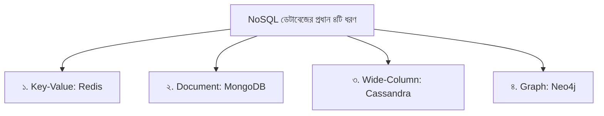
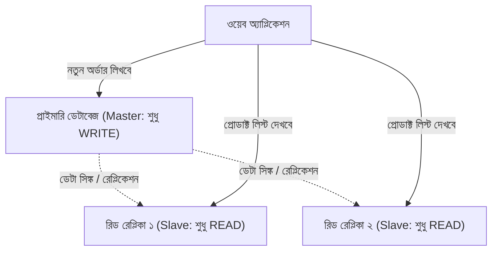

# 🗺️ আল্টিমেট ডেটাবেজ ব্লুপ্রিন্ট ও হ্যান্ডবুক (Zero to Mastery)

> এই গাইডটিতে ডেটাবেজের প্রতিটি কনসেপ্টকে তিনটি স্তরে ভাগ করে বোঝানো হয়েছে:
> 1. **বাস্তব জীবনের রূপক (Kid-friendly Analogy):** সাধারণ জীবনের সহজ উদাহরণ দিয়ে মস্তিষ্কে ধারণা তৈরি করা।
> 2. **টেকনিক্যাল ব্যাখ্যা (Deep Technical Concepts):** কম্পিউটার বিজ্ঞানের ভাষায় ভেতরের মেকানিজম ব্যাখ্যা।
> 3. **প্র্যাকটিক্যাল কোড ও উদাহরণ (Practical Implementation):** আপনার প্রোজেক্টে কীভাবে কাজে লাগাবেন।

---

## 🧭 মেগা রোডম্যাপ সূচিপত্র (কোনটির পর কোনটি শিখবেন)



---

## মডিউল ১: ডেটাবেজ ফাউন্ডেশন ও স্কিমা আর্কিটেকচার (Database Foundation & Schema Design)

### ১.১ ডেটাবেজ (Database) বনাম ডিবিএমএস (DBMS / RDBMS)
* **বাচ্চাদের মতো গল্প:**  
  ডেটাবেজ হলো আপনার বাড়ির **"রান্নাঘরের মসলার তাক"**, যেখানে গোলমরিচ, হলুদ, মরিচ সাজানো থাকে। আর **DBMS (Database Management System)** হলো একজন **"সুদক্ষ শেফ বা বাবুর্চি"**। আপনি বাবুর্চিকে বললেন: *"আমাকে একটু হলুদ এনে দাও"*, সে গিয়ে নির্দিষ্ট বয়াম থেকে মসলা এনে দেয়। আপনি নিজে গিয়ে হাত দিয়ে ঘাঁটাহাটি করেন না; শেফ সব নিরাপত্তা আর পরিচ্ছন্নতা বজায় রেখে কাজ করে।
* **টেকনিক্যাল টার্ম ও বিশদ ব্যাখ্যা:**  
  - **Database:** ডিস্কে সংরক্ষিত স্ট্রাকচার্ড তথ্যের সংগ্রহ (Files on disk)।  
  - **DBMS / RDBMS:** সফটওয়্যার লেয়ার (যেমন: MySQL, PostgreSQL, SQLite) যা মেমোরি ম্যানেজমেন্ট, ডিস্ক আই/ও (Disk I/O), নিরাপত্তা ও কুয়েরি প্রসেসিং পরিচালনা করে।
* **বাস্তব উদাহরণ:**  
  একটি ই-কমার্স সাইটে হাজার হাজার কাস্টমার ও পণ্যের বিবরণ যে ইঞ্জিন নিরাপদে গুছিয়ে রাখে, সেটিই RDBMS।

---

### ১.২ ডেটা টাইপস (Data Types)
* **বাচ্চাদের মতো গল্প:**  
  আপনি কি চকলেটের বাক্সে তরল স্যুপ রাখতে পারবেন? অথবা পানির বোতলে বড় একটা ফুটবল ঢোকাতে পারবেন? পারবেন না। সব জিনিসের জন্য আলাদা পাত্র দরকার। ডেটাবেজেও কোন তথ্যের জন্য কতটুকু জায়গা লাগবে, তার নির্দিষ্ট পাত্রই হলো **Data Type**।
* **টেকনিক্যাল টার্ম ও বিশদ ব্যাখ্যা:**
  1. **Integer (`INT`, `BIGINT`, `TINYINT`):** পূর্ণসংখ্যা। যেমন ইউজারের বয়স, স্টক সংখ্যা। `TINYINT` ১ বাইট (০-২৫৫), `BIGINT` ৮ বাইট।
  2. **String / Text (`VARCHAR`, `TEXT`):** টেক্সট তথ্য।  
     - `VARCHAR(255)`: পরিবর্তনশীল দৈর্ঘ্য (Dynamic Length)। যতোটুকু অক্ষর লিখবেন, ততোটুকু মেমোরি খরচ হবে।
     - `TEXT`: বড় ডেসক্রিপশন বা ব্লগ পোস্টের জন্য।
  3. **Decimal / Float (`DECIMAL(10,2)`):** ভগ্নাংশ।  
     > [!CAUTION]  
     > টাকার বা ব্যালেন্সের হিসাবের জন্য কখনই `FLOAT` ব্যবহার করবেন না, কারণ এতে রাউন্ডিং এরর (Rounding Error) হয়। টাকার জন্য সবসময় ফিক্সড-পয়েন্ট `DECIMAL` ব্যবহার করতে হবে।
  4. **Boolean (`BOOLEAN` বা `TINYINT(1)`):** সত্য (`true` / `1`) বা মিথ্যা (`false` / `0`)। যেমন: `is_active`, `is_paid`।
  5. **Date / Time (`TIMESTAMP`, `DATETIME`):** সময় সংরক্ষণে। সবসময় টাইমজোন (UTC) মাথায় রাখা দরকার।
  6. **JSON (`JSON` / `JSONB`):** অবিন্যস্ত কিন্তু স্ট্রাকচার্ড ডেটা সংরক্ষণের জন্য (যেমন পেমেন্ট গেটওয়ের অডিট রেসপন্স)।

---

### ১.৩ কনস্ট্রেইন্টস (Constraints / ডেটাবেজের ট্রাফিক পুলিশ)
* **বাচ্চাদের মতো গল্প:**  
  স্কুলে ঢুকতে হলে ইউনিফর্ম পরা বাধ্যতামূলক, আইডি কার্ড ছাড়া ক্লাসে বসা যাবে না। ডেটাবেজে কোনো টেবিলের ভেতর ভুল বা উল্টাপাল্টা তথ্য ঢোকা আটকাতে যে নিয়মগুলো বেঁধে দেওয়া হয়, সেগুলোই **Constraints**।
* **প্রধান কনস্ট্রেইন্টসমূহ:**
  - `NOT NULL`: এই কলাম কখনই খালি (Empty) রাখা যাবে না। (যেমন: কাস্টমারের নাম ছাড়া সাইনআপ করা যাবে না)।
  - `UNIQUE`: কোনো দুজন মানুষের এই তথ্য এক হতে পারবে না। (যেমন: ইমেইল বা ফোন নম্বর)।
  - `DEFAULT`: যদি ইউজার কিছু না দেয়, তবে নিজে থেকেই একটা মান বসে যাবে। (যেমন: নতুন অর্ডারের ক্ষেত্রে `status` ডিফল্ট হিসেবে `'pending'` থাকবে)।
  - `CHECK`: ডেটার মানের ওপর শর্ত বসানো। (যেমন: `CHECK (age >= 18)` বা `CHECK (price > 0)`)।

---

## মডিউল ২: রিলেশনশিপ ও নরমালাইজেশন (Relationships & Normalization)

### ২.১ প্রাইমারি কি ও ফরেন কি (PK & FK)
* **বাস্তব জীবনের গল্প:**  
  - **Primary Key (PK):** আপনার জাতীয় পরিচয়পত্র (NID) নম্বর। এটি দিয়ে দেশে আপনাকে এককভাবে চিহ্নিত করা যায়।
  - **Foreign Key (FK):** আপনার পাসপোর্টে আপনার বাবার NID নম্বর লিখে রাখা হয়েছে। যাতে যে কেউ পাসপোর্ট দেখলেই বাবার তথ্য বের করে আনতে পারে। বাবার পুরো বায়োডাটা বারবার পাসপোর্টে লিখতে হয় না।
* **টেকনিক্যাল টার্ম:**
  - `PRIMARY KEY`: একটি টেবিলে একটি ইউনিক ক্লাস্টার্ড ইনডেক্স করা কলাম যা কখনই `NULL` হতে পারে না।
  - `FOREIGN KEY`: অন্য একটি টেবিলের প্রাইমারি কি-কে রেফারেন্স করে রিলেশন তৈরি করা।

---

### ২.২ রিলেশনশিপের ৩টি রূপ (Relationships)



#### ১. One-to-One (১:১):
- **গল্প:** একজন মানুষের একটাই ড্রাইভিং লাইসেন্স থাকে।
- **কোড প্রয়োগ:** `users` টেবিল এবং `user_profiles` টেবিল। প্রোফাইল টেবিলে `user_id` ইউনিক থাকে।

#### ২. One-to-Many (১:বহু):
- **গল্প:** একজন মায়ের একাধিক সন্তান থাকতে পারে, কিন্তু প্রতিটি সন্তানের জৈবিক মা একজনই।
- **কোড প্রয়োগ:** একজন কাস্টমার অনেকগুলো অর্ডার করতে পারেন। `orders` টেবিলে `customer_id` কলামটি ফরেন কি হিসেবে থাকে।

#### ৩. Many-to-Many (বহু:বহু):
- **গল্প:** একজন ছাত্র একাধিক ক্লাসে পড়ে, আবার একটি ক্লাসে একাধিক ছাত্র থাকে।
- **কোড প্রয়োগ:** অর্ডার এবং প্রোডাক্ট। একটি অর্ডারে অনেক শার্ট থাকতে পারে, আবার একটি শার্ট হাজারটা অর্ডারে থাকতে পারে।
- **সমাধান (Pivot Table):** দুটি টেবিলকে সরাসরি জোড়া দেওয়া যায় না। তাই মাঝখানে একটি ৩য় টেবিল লাগে (যেমন: `order_items` টেবিল), যেখানে `order_id` এবং `product_id` থাকে।

---

### ২.৩ রেফারেন্সিয়াল ইন্টিগ্রিটি ও ক্যাসকেডিং (Cascade Rules)
* **বাচ্চাদের মতো গল্প:**  
  স্কুল থেকে যদি কোনো ছাত্রের নাম কেটে দেওয়া হয়, তাহলে তার হোস্টেলের সিট এবং লাইব্রেরি কার্ডের তথ্য স্বয়ংক্রিয়ভাবে বাতিল হয়ে যাওয়া উচিত। না হলে ডেটাবেজে "ভূতুড়ে রেকর্ড" (Orphan Records) পড়ে থাকবে।
* **টেকনিক্যাল রুলস:**
  - `ON DELETE CASCADE`: প্যারেন্ট ডিলিট হলে চাইল্ড রেকর্ডও ডিলিট হয়ে যাবে। (যেমন: ইউজার ডিলিট হলে তার সেশনও মুছে যাবে)।
  - `ON DELETE RESTRICT / NO ACTION`: চাইল্ড ডাটা থাকলে প্যারেন্টকে ডিলিট করতে দেবে না। (যেমন: কোনো কাস্টমারের যদি অর্ডার হিস্ট্রি থাকে, তবে তাকে ডিলিট করতে বাধা দেবে)।
  - `ON DELETE SET NULL`: প্যারেন্ট ডিলিট হলে চাইল্ডের সেই ঘরে `NULL` বসবে।

---

### ২.৪ নরমালাইজেশন (Normalization: ১NF, ২NF, ৩NF)
* **কেন দরকার?** ডেটাবেজে একই তথ্য বারবার লিখলে (Data Redundancy) মেমোরি নষ্ট হয় এবং একটা আপডেট করলে অন্য জায়গায় পুরোনো ডেটা থেকে যায় (Update Anomaly)।
* **সহজ ব্যাখ্যা:**
  - **1NF (First Normal Form - "এক ঘরে একজন"):** এক কলামে কমা দিয়ে একাধিক নাম বা ফোন নম্বর লেখা যাবে না। প্রতিটি ঘরে একটি মাত্র একক মান (Atomic Value) থাকতে হবে।
  - **2NF (Second Normal Form - "পুরো পরিচয়"):** টেবিলের প্রতিটি কলামের তথ্য পুরো প্রাইমারি কি-এর ওপর নির্ভর করতে হবে, আংশিক কি-এর ওপর নয়।
  - **3NF (Third Normal Form - "তৃতীয় পক্ষের হস্তক্ষেপ নয়"):** টেবিলের কোনো সাধারণ কলাম যেন অন্য কোনো সাধারণ কলামের ওপর নির্ভর না করে (No Transitive Dependency)। যেমন: কাস্টমার টেবিলে `city` থাকলে সেখানে `division` লেখার দরকার নেই; ডিভিশনের জন্য আলাদা সিটি-ডিভিশন টেবিল থাকবে।

---

## মডিউল ৩: কুয়েরি ইঞ্জিনিয়ারিং (SQL Deep Dive)

ডেটাবেজের সাথে কথা বলার আন্তর্জাতিক ভাষা হলো **SQL**।

### ৩.১ কুয়েরি এক্সিকিউশন অর্ডার (SQL Query Execution Order)
> [!IMPORTANT]
> আপনি যেভাবে SQL লেখেন, ডেটাবেজ কিন্তু সেভাবে পড়ে না! ডেটাবেজ কীভাবে ধাপে ধাপে একটি কুয়েরি প্রসেস করে তা বুঝলে জটিল কুয়েরি লেখা সহজ হয়ে যায়:



* আপনি লেখেন `SELECT` প্রথমে, কিন্তু ডেটাবেজ সবার আগে দেখে **কোন টেবিল থেকে ডেটা নিতে হবে (`FROM`)**।

---

### ৩.২ জয়েন (JOINs): টেবিল জোড়া লাগানোর জাদু
* **বাস্তব উদাহরণ:** কাস্টমারের নাম আছে এক খাতায়, আর কোন তারিখে কত টাকার কাপড় বিক্রি হলো তা আছে আরেক খাতায়। দুটি খাতা একসাথে মিলিয়ে পড়া।



* **INNER JOIN:** শুধু সেই কাস্টমারদের আনবে যারা অন্তত একটি অর্ডার করেছে।
  ```sql
  SELECT customers.name, orders.total_amount 
  FROM customers 
  INNER JOIN orders ON customers.id = orders.customer_id;
  ```
* **LEFT JOIN:** সব কাস্টমারকে আনবে; যারা কোনো অর্ডার করেনি তাদের নামের পাশে টাকার ঘর `NULL` দেখাবে।

---

### ৩.৩ এগ্রিগেশন ও ফিল্টারিং (GROUP BY ও HAVING)
* **সহজ উদাহরণ:**  
  দোকানে সারা মাসের সব বিক্রির রশিদ থেকে বের করা: *"কোন শহরে সবচেয়ে বেশি বিক্রি হয়েছে?"*
* **GROUP BY:** ডেটাগুলোকে শহরের ভিত্তিতে ছোট ছোট ব্যাগে ভাগ করা।
* **HAVING:** গ্রুপ করার পর সেই গ্রুপের ওপর ফিল্টার বসানো।  
  *(নোট: সাধারণ রো ফিল্টার করতে `WHERE` বসে, আর এগ্রিগেট করা ডেটা ফিল্টার করতে `HAVING` বসে)।*

```sql
SELECT city, COUNT(id) as total_customers, SUM(spent_amount) as total_revenue
FROM customers
WHERE created_at >= '2026-01-01'
GROUP BY city
HAVING total_revenue > 50000;
```

---

### ৩.৪ সাবকুয়েরি বনাম উইন্ডো ফাংশন (Subqueries & Window Functions)
* **Subquery:** কুয়েরির পেটের ভেতরে আরেকটা কুয়েরি।
* **Window Functions (`OVER`, `PARTITION BY`, `ROW_NUMBER()`):** পুরো টেবিলকে না ভেঙে প্রতিটি রো-এর সাপেক্ষে র্যাংক বা রানিং টোটাল বের করা।  
  *(যেমন: প্রতিটি ক্যাটাগরির সেরা ৩টি দামি প্রোডাক্ট খুঁজে বের করা)।*

---

## মডিউল ৪: ইনডেক্সিং ও পারফরম্যান্স টিউনিং (Indexing & Optimization)

### ৪.১ ইনডেক্স (Index) কীভাবে কাজ করে? (B-Tree মেকানিজম)
* **বাচ্চাদের মতো গল্প:**  
  আপনি ডিকশনারিতে যখন কোনো শব্দ খোঁজেন, আপনি কি প্রথম পৃষ্ঠা থেকে শুরু করেন? না। আপনি জানেন ডিকশনারির শব্দগুলো বর্ণানুক্রমিকভাবে সাজানো। আপনি বইয়ের মাঝখানে খোলেন, দেখেন শব্দটি কি বাঁয়ে না ডানে, এবং কয়েক সেকেন্ডেই নির্দিষ্ট শব্দে পৌঁছে যান।  
* **টেকনিক্যাল ব্যাখ্যা (B-Tree Data Structure):**  
  ডেটাবেজের ইনডেক্স মূলত একটি ব্যালেন্সড ট্রি (B-Tree)।
  - ইনডেক্স ছাড়া খোঁজা মানে: **Full Table Scan (O(N) Complexity)** — ১ কোটি রো থাকলে ১ কোটি বার চেক করতে হবে।
  - ইনডেক্স থাকলে খোঁজা মানে: **Tree Traversal (O(log N) Complexity)** — ১ কোটি রো-এর ভেতর থেকে মাত্র ২০-২৫ বার চেক করেই নির্দিষ্ট ডেটা বের হয়ে যাবে!



---

### ৪.২ ইনডেক্সের ধরণ
1. **Clustered Index:** টেবিলের মূল ডেটা ডিস্কে কীভাবে ফিজিক্যালি সাজানো থাকবে। একটি টেবিলে কেবল **একটিই** ক্লাস্টার্ড ইনডেক্স হতে পারে (সাধারণত `Primary Key`)।
2. **Secondary / Non-Clustered Index:** মূল ডেটা আলাদা থাকে, ইনডেক্স পয়েন্টার হিসেবে অন্য একটি তালিকায় সাজানো থাকে।
3. **Composite Index (মাল্টি-কলাম ইনডেক্স):** একাধিক কলাম একসাথে মিলে তৈরি ইনডেক্স (যেমন: `INDEX(status, created_at)`)।  
   > [!TIP]  
   > **Leftmost Prefix Rule:** কম্পোজিট ইনডেক্স `(A, B)` দিলে, এটি `WHERE A = 1` অথবা `WHERE A = 1 AND B = 2` এর জন্য কাজ করবে, কিন্তু শুধু `WHERE B = 2` এর জন্য কাজ করবে না।

---

### ৪.৩ EXPLAIN কমান্ড: ডেটাবেজ কীভাবে চিন্তা করে?
যেকোনো কুয়েরি রান করার আগে তার সামনে `EXPLAIN` লিখে রান করুন:
```sql
EXPLAIN SELECT * FROM orders WHERE status = 'shipped' AND user_id = 45;
```
* **দেখার মতো মূল জিনিস:**
  - `type`: `ALL` মানে খারাপ (পুরো টেবিল স্ক্যান করছে)। `ref` বা `range` বা `const` মানে ইনডেক্স কাজে লেগেছে।
  - `possible_keys`: ডেটাবেজ কোন কোন ইনডেক্স ব্যবহার করতে পারত।
  - `key`: শেষ পর্যন্ত ডেটাবেজ কোন ইনডেক্সটি পছন্দ করেছে।
  - `rows`: এই কুয়েরি চালাতে ডেটাবেজকে আনুমানিক কতগুলো রো পরীক্ষা করতে হয়েছে।

---

## মডিউল ৫: ট্রানজ্যাকশন, কনকারেন্সি ও ACID (Transactions & Concurrency)

### ৫.১ ACID ডিপ-ডাইভ
* **A - Atomicity (অল-অর-নাথিং):** সব কোড সফল হলে `COMMIT`, কোনো একটা লাইন ফেইল করলে পুরোটা আগের জায়গায় ফেরত `ROLLBACK`।
* **C - Consistency (নিয়মের সুরক্ষা):** ডেটাবেজের কোনো কনস্ট্রেইন্ট বা ফরেন কি ভায়োলেট হতে পারবে না।
* **I - Isolation (আইসোলেশন):** দুজন ইউজার একই সময়ে হিট করলেও কেউ কারও কাঁচা ডেটা দেখতে পাবে না।
* **D - Durability (স্থায়িত্ব):** ট্রানজ্যাকশন সফল হলে হার্ডডিস্কে ডেটা পার্মানেন্টলি লেখা সম্পন্ন হবে (WAL বা Write-Ahead Logging এর মাধ্যমে)।

---

### ৫.২ কনকারেন্সি প্রবলেম ও লকিং (Race Condition & Locks)
* **বাচ্চাদের মতো গল্প:**  
  দোকানে শেষ **১টি মাত্র লাল জামা** বাকি আছে। একই সময়ে ঢাকা থেকে রহিম এবং চট্টগ্রাম থেকে করিম ওয়েবসাইটে "Buy Now" বাটনে ক্লিক করলেন।  
  যদি ডেটাবেজ সামলাতে না পারে, তবে দুজনের কার্ড থেকেই টাকা কেটে নেবে, কিন্তু জামা তো আছে মাত্র একটা! একে বলে **Race Condition**।
* **সমাধান (Locking):**
  - **Pessimistic Locking (`SELECT ... FOR UPDATE`):** রহিম যখন জামাটি কিনতে ঢুকবে, ডেটাবেজ ওই রো-তে তালা মেরে দেবে। করিমকে লাইনে দাঁড় করিয়ে রাখবে। রহিমের পেমেন্ট শেষ হলে করিম দেখবে "Stock Out"।
  - **Optimistic Locking:** কোনো তালা মারা হয় না, তবে ডেটাতে একটা `version` কলাম থাকে। আপডেটের সময় দেখা হয় ভার্সন মিলেছে কি না। না মিললে এরর দিয়ে পুনরায় চেষ্টা করতে বলা হয়।

---

## মডিউল ৬: স্টোরেজ ইঞ্জিন ও ইন্টারনালস (Storage Engines & Internals)

### ৬.১ ইন-মেমোরি বনাম ডিস্ক স্টোরেজ (InnoDB Internals)
* ডেটাবেজ দ্রুত কাজ করার জন্য ডেটা সরাসরি ডিস্ক থেকে পড়ে না।
* **Buffer Pool:** র‍্যামের (RAM) একটি নির্দিষ্ট অংশ, যেখানে ঘন ঘন ব্যবহৃত টেবিল পেজগুলো ক্যাশ আকারে রাখা হয়।
* **Write-Ahead Logging (WAL / Redo Log):** ডেটাবেজ যখন কোনো কিছু সেভ করে, সে তাৎক্ষণিকভাবে বিশাল টেবিল ফাইলে গিয়ে লেখে না (কারণ এতে ডিস্ক স্লো হয়)। সে দ্রুত একটি লগ ফাইলে (Redo Log) লিখে ফেলে। পরে অলস সময়ে ব্যাকগ্রাউন্ড প্রসেস আসল ফাইলে লিখে দেয়।

---

## মডিউল ৭: NoSQL পরিবার ও আধুনিক আর্কিটেকচার (NoSQL Ecosystem)

কখন SQL ছেড়ে NoSQL এ যাবেন?



1. **Key-Value Store (যেমন: Redis):**  
   - মেমোরিতে (RAM) চলে, আলোর গতিতে কাজ করে।
   - **ব্যবহার:** ইউজার সেশন, ওটিপি (OTP), শপিং কার্ট ক্যাশিং, রেট লিমিট।
2. **Document Database (যেমন: MongoDB):**  
   - কোনো নির্দিষ্ট স্কিমা বা টেবিল নেই। JSON অবজেক্ট হিসেবে ডেটা থাকে।
   - **ব্যবহার:** ব্লগ, কনটেন্ট ম্যানেজমেন্ট, প্রডাক্ট ক্যাটালগ যেখানে বিভিন্ন প্রডাক্টের বিভিন্ন ফিল্ড থাকে (যেমন: মোবাইলের জন্য RAM/Processor, কাপড়ের জন্য Size/Color)।
3. **Graph Database (যেমন: Neo4j):**  
   - মানুষের সাথে মানুষের সম্পর্ক বা ফ্রেন্ডলিস্ট খোঁজার জন্য ("Friends of Friends")।

---

## মডিউল ৮: হাই-অ্যাভেইলেবিলিটি, রেপ্লিকেশন ও স্কেলিং (Scaling & Architecture)

যখন আপনার অ্যাপে কোটি কোটি ইউজার আসবে, একটি সিঙ্গেল সার্ভার লোড নিতে পারবে না।



1. **Read-Replication (মাস্টার-স্লেভ):**  
   - লেখার কাজ (Insert/Update) হবে মূল মাস্টারে।
   - লাখ লাখ মানুষ যখন শুধু ব্রাউজ করবে (Read), তাদের রিকোয়েস্ট যাবে রেপ্লিকা সার্ভারে।
2. **Database Sharding (পার্টিশনিং):**  
   - টেবিলকে টুকরো টুকরো করে একাধিক সার্ভারে ভাগ করে ফেলা। যেমন: ইউজার আইডি ১ থেকে ১০ লাখ এক সার্ভারে, ১১ থেকে ২০ লাখ অন্য সার্ভারে।
3. **Connection Pooling:**  
   - বারবার ডেটাবেজের সাথে নতুন কানেকশন তৈরি ও বন্ধ করতে অনেক সিপিইউ খরচ হয়। তাই কিছু কানেকশন সবসময় জীবন্ত রাখা হয়।

---

## মডিউল ৯: সিকিউরিটি, ব্যাকআপ ও প্রোজেক্ট চেকলিস্ট (Production Readiness)

### ৯.১ এসকিউএল ইনজেকশন প্রতিরোধ (SQL Injection Defense)
* **বিপদ:** ইউজার ইনপুটের জায়গায় কুয়েরি কোড লিখে পুরো ডেটাবেজ ডিলিট করে দেওয়া।
* **সোনালী নিয়ম:** কখনই স্ট্রিং কনক্যাট করে কুয়েরি বানাবেন না (`"SELECT * FROM users WHERE email = '" + input + "'"` ❌)।
* **সমাধান:** সবসময় **Prepared Statements / Parameterized Queries** ব্যবহার করতে হবে (`SELECT * FROM users WHERE email = ?` ✅)।

---

## 🛠️ হ্যান্ডস-অন প্র্যাকটিস প্রোজেক্ট: একটি ই-কমার্স ডেটাবেজ ডিজাইন

এই রোডম্যাপ পড়ে আপনি নিজেই একটি ই-কমার্স ব্যাকএন্ডের পূর্ণাঙ্গ স্কিমা তৈরি করার যোগ্যতা অর্জন করবেন:

```sql
-- ১. ইউজার টেবিল
CREATE TABLE users (
    id BIGINT UNSIGNED AUTO_INCREMENT PRIMARY KEY,
    name VARCHAR(100) NOT NULL,
    email VARCHAR(150) NOT NULL UNIQUE,
    password_hash VARCHAR(255) NOT NULL,
    created_at TIMESTAMP DEFAULT CURRENT_TIMESTAMP
) ENGINE=InnoDB;

-- ২. ক্যাটাগরি টেবিল
CREATE TABLE categories (
    id INT UNSIGNED AUTO_INCREMENT PRIMARY KEY,
    name VARCHAR(50) NOT NULL,
    slug VARCHAR(60) NOT NULL UNIQUE
) ENGINE=InnoDB;

-- ৩. প্রোডাক্ট টেবিল
CREATE TABLE products (
    id BIGINT UNSIGNED AUTO_INCREMENT PRIMARY KEY,
    category_id INT UNSIGNED NOT NULL,
    title VARCHAR(200) NOT NULL,
    price DECIMAL(10, 2) NOT NULL,
    stock INT UNSIGNED DEFAULT 0,
    created_at TIMESTAMP DEFAULT CURRENT_TIMESTAMP,
    FOREIGN KEY (category_id) REFERENCES categories(id) ON DELETE RESTRICT,
    INDEX idx_category_price (category_id, price)
) ENGINE=InnoDB;

-- ৪. অর্ডার টেবিল (ACID সমর্থিত)
CREATE TABLE orders (
    id BIGINT UNSIGNED AUTO_INCREMENT PRIMARY KEY,
    user_id BIGINT UNSIGNED NOT NULL,
    total_amount DECIMAL(10, 2) NOT NULL,
    status ENUM('pending', 'paid', 'shipped', 'cancelled') DEFAULT 'pending',
    created_at TIMESTAMP DEFAULT CURRENT_TIMESTAMP,
    FOREIGN KEY (user_id) REFERENCES users(id) ON DELETE CASCADE,
    INDEX idx_user_status (user_id, status)
) ENGINE=InnoDB;
```

---

### আপনার প্রতিদিনের শেখার প্ল্যান (Weekly Schedule):
* **সপ্তাহ ১:** মডিউল ১ ও ২ (বেসিক টেবিল, ডেটা টাইপ, প্রাইমারি-ফরেন কি, ৩টি রিলেশনশিপ প্র্যাকটিস)।
* **সপ্তাহ ২:** মডিউল ৩ (SQL জয়েন, গ্রুপ বাই, সাবকুয়েরি প্র্যাকটিস)।
* **সপ্তাহ ৩:** মডিউল ৪ ও ৫ (ইনডেক্সিং বসানো, `EXPLAIN` কুয়েরি রান করে দেখা, ট্রানজ্যাকশন কোড লেখা)।
* **সপ্তাহ ৪:** মডিউল ৬, ৭ ও ৮ (Redis দিয়ে ক্যাশিং ট্রাই করা, মাস্টার-স্লেভ কনসেপ্ট এবং সিকিউরিটি অডিট)।
